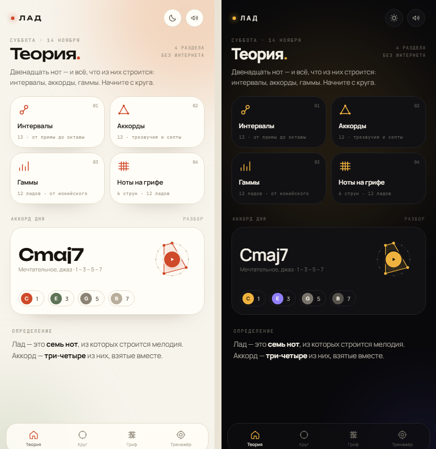

# ЛАД — приложение по теории музыки для гитаристов

[](https://github.com/DDaaBBrrOO/guitarchords/actions/workflows/android.yml)

**Скачать APK:** [последний релиз](https://github.com/DDaaBBrrOO/guitarchords/releases/latest) — подписан ключом `CN=LAD`, ставится на Android 7.0+ без интернета и без разрешений.

Две темы одного Android-приложения: интервалы, построение аккордов, ноты в аккордах
и гаммы. Всё ядро — хроматический круг из 12 нот, на котором одновременно живут
интервалы (дуга), аккорды (треугольник) и гаммы (семиугольник).



## Как смотреть

Открыть `index.html` в браузере — это витрина: два «телефона» в живых iframe
и переключатель экрана (Теория / Круг · аккорд / Круг · гамма / Гриф / Тренажёр).

Прямые ссылки на прототип:

```
app.html?theme=air   &screen=home|circle|neck|train  &mode=chord|scale|interval
app.html?theme=night
```

Дополнительно: `&demo=answered` — тренажёр в состоянии «ответ дан»,
`&demo=harmony` — экран круга с чипом возврата к гамме.

## Проверить на компьютере, не беря телефон

Приложение — это HTML, поэтому на компьютере оно запускается тем же кодом,
что лежит внутри APK. Два способа:

```powershell
# витрина: два «телефона» в живых окнах, как на скриншотах
tools\dev.ps1

# только приложение в окне 430×900, без адресной строки — как на телефоне
tools\dev.ps1 -App
tools\dev.ps1 -App -Theme night -Screen circle
```

Скрипт поднимает локальный сервер (`tools/serve.mjs`, без зависимостей) и
открывает Chrome в режиме `--app` с отдельным профилем. Закрыли окно — сервер
остаётся жить в фоне; следующий запуск переиспользует его. Порт по умолчанию
5180, меняется параметром `-Port`.

Внутри окна работают все жесты и звук: круг тянется мышью, струны и клавиши
кликаются, тренажёр считает время и ошибки. Единственное отличие от телефона —
нет системных панелей Android, их отступы эмулирует только оболочка.

### Если нужен именно APK

| Способ | Что нужно | Когда подходит |
|---|---|---|
| **Эмулятор (скрипт)** | `tools\emulator.ps1` — сам создаст AVD, поднимет эмулятор и поставит APK | проверить установку, статус-бар, иконки |
| **Телефон по USB (скрипт)** | `tools\phone.ps1` — ставит APK на подключённый телефон и открывает приложение | живой тест без нагрузки на компьютер |
| `emulator` из командной строки | `sdkmanager "emulator" "system-images;android-35;google_apis;x86_64"` + AVD | без Android Studio, но ~1.5 ГБ загрузки |
| Телефон по USB вручную | `adb install -r app-debug.apk`, зеркало экрана — `scrcpy` | когда скрипта мало |

```powershell
cd C:\projects\chords
powershell -File tools\emulator.ps1                      # запуск + установка
powershell -File tools\emulator.ps1 -Shot shot.png       # ещё и скриншот экрана
powershell -File tools\emulator.ps1 -Fresh               # пересоздать AVD
```

Первый запуск эмулятора — до двух минут (потом он живёт в фоне и
переиспользуется). Если APK не ставится из-за подписи, скрипт сам делает
чистую переустановку. SDK лежит в `.toolchain\sdk` и в репозиторий не попадает:
при первом запуске `emulator.ps1` подскажет, чего не хватает.

Эмулятор удобен для проверки того, чего нет в браузере: отступов системных
панелей, тёмных иконок статус-бара, установки поверх старой версии. Всё
остальное быстрее смотреть в Chrome.

### Телефон по USB

Телефон считает всё сам, компьютер только отправляет APK — эмулятор и его
память не нужны.

1. На телефоне: «О телефоне» → «Сведения о ПО» → 7 раз тапнуть по «Номер
   сборки». Появится «Параметры разработчика».
2. В них включить «Отладка по USB».
3. Подключить кабель, в уведомлении выбрать «Передача файлов», на телефоне
   согласиться с «Разрешить отладку по USB».

```powershell
cd C:\projects\chords
powershell -File tools\phone.ps1                    # поставить и открыть
powershell -File tools\phone.ps1 -Shot shot.png     # плюс скриншот с телефона
powershell -File tools\phone.ps1 -Clean             # снести и поставить заново
powershell -File tools\phone.ps1 -Log               # посмотреть logcat
```

Скрипт печатает модель и версию Android, сам обходит конфликт подписи и
объясняет, что делать, если телефон «unauthorized». Посмотреть экран телефона
на мониторе можно через `scrcpy` (портативный архив с GitHub, установка не
нужна): `scrcpy --max-size 900`.

## Две темы

| | Тема | Характер |
|---|---|---|
| A | `air` — Воздух | тёплая бумага, терракота, Unbounded, дневной свет |
| B | `night` — Ночь | почти чёрный, золото тонов, свечение — ближе всего к референсу |

Тема — набор CSS-переменных на `.app[data-theme=…]`; разметка и логика общие.
Переключатель в шапке, выбор запоминается в `localStorage`, по умолчанию —
системная тема. Прежние «Стекло» и «Партитура» остались в истории как направления
и в сборку не входят.

## Что умеет прототип

- **Круг.** 12 нот по часовой стрелке от C. Интервал — дуга с подписью «+7»,
  аккорд — замкнутый полигон, гамма — семиугольник. Ступень (1, 3, 5, 7) написана
  прямо в активной ноте, сольфеджио — в неактивной. Фигуру можно тянуть пальцем:
  тональность меняется, тип аккорда, лад или интервал сохраняется.
- **Аккорды.** 12 типов (мажор, минор, dom7, maj7, m7, dim, aug, sus2, sus4, 6, m6, 9),
  12 основных тонов, обращения, правильное буквенное спеллингование (B♭, E♭, F♯).
- **Гаммы.** 12 ладов, гармонизация трезвучий по ступеням с римскими цифрами;
  из «аккордов в тональности» есть возврат к той же гамме одним тапом.
- **Интервалы.** 13 интервалов от примы до октавы, количество полутонов и характер.
- **Гриф.** Вертикальный гриф 0–12 ладов: слева 6-я струна (толстая), справа 1-я
  (тонкая), строй E A D G B E, режимы «Ноты / Аккорд / Гамма», подсветка ступеней
  и легенда; вся октава видна без прокрутки. В режиме «Аккорд» — аппликатуры
  выбранного аккорда (открытые формы и баррэ), тап по схеме проигрывает её.
- **Тренажёр.** Шесть режимов и настройка перед серией:

  | Режим | Что делает |
  |---|---|
  | Ноты на грифе | «Где нота X на N-й струне?» — полоска ладов, длина зависит от сложности |
  | Ноты в аккорде | собрать состав аккорда тапом по колесу |
  | Сборка аккорда | дана тоника и формула (1 · ♭3 · 5) — собрать ноты |
  | Сборка гаммы | отметить все ноты лада на колесе |
  | Интервалы на слух | играют два звука — выбрать интервал из четырёх |
  | Аккорды на слух | играет аккорд — определить тип |

  Сложность меняет набор: «Новичок» — белые клавиши, трезвучия и 6 ладов,
  «Уверенный» — септы и все тональности, «Профи» — всё, включая пентатоники
  и дальние лады. Серия — 10 вопросов, считаются точность и лучшая серия.
- **Звук.** Web Audio без сэмплов: щипок (треугольник + синус через lowpass),
  арпеджио, страм, buzz при ошибке.

## Файлы

```
index.html            витрина двух тем
app.html              прототип приложения (один на обе темы)
assets/app.css        токены тем + вся вёрстка
assets/app.js         теория, SVG-отрисовка, звук, состояние
assets/fonts/         локальные woff2 + fonts.css (интернет не нужен)
android/              Android-оболочка (WebView) и сборка APK
.github/workflows/    CI: debug APK на push, подписанный релиз по тегу
tools/shot.ps1        скриншоты через headless Chrome
tools/dev.ps1         локальный запуск на компьютере (сервер + окно Chrome)
tools/serve.mjs       мини-сервер без зависимостей
tools/fetch-fonts.mjs обновление локальных шрифтов
tools/make-icons.py   лаунчер-иконки
docs/                 картинки для README
```

## Android-приложение

`android/` — тонкая оболочка на WebView: интерфейс целиком берётся из `app.html`
и `assets/`, которые Gradle копирует в `assets/www` перед сборкой (задача
`syncWebAssets`). Приложение не просит INTERNET и работает офлайн: шрифты и звук
синтезируются на месте. Отступы системных панелей снимает контейнер, а иконки
статус-бара красятся под выбранную тему через мост `LadHost`.

### Собрать APK без установленного Android SDK

Ничего ставить не нужно — всё делает GitHub Actions:

1. Запушьте репозиторий (ветка `main`).
2. Откройте **Actions → Android → Run workflow** или просто сделайте push.
3. Через 3–5 минут в артефактах job'а лежит `app-debug.apk` — скачивается и
   ставится на телефон.

### Собрать локально

```bash
cd android
./gradlew assembleDebug
# APK: android/app/build/outputs/apk/debug/app-debug.apk
```

Нужен JDK 17 и Android SDK (или Android Studio: File → Open → папка `android/`).

### Подписанный релиз

Тег `v*` запускает job `release`: он собирает `app-release.apk` и `app-release.aab`,
подписывает их ключом из Secrets и прикрепляет к GitHub Release.

| Secret | Что внутри |
|---|---|
| `KEYSTORE_BASE64` | ваш `.jks` в base64: `base64 -w0 lad.jks` |
| `KEYSTORE_PASSWORD` | пароль хранилища |
| `KEY_ALIAS` | алиас ключа |
| `KEY_PASSWORD` | пароль ключа |

```bash
keytool -genkeypair -v -keystore lad.jks -alias lad -keyalg RSA \
        -keysize 2048 -validity 10000
base64 -w0 lad.jks   # Windows: certutil -encode lad.jks lad.b64
```

Перед новым релизом поднимайте `versionCode`/`versionName` в
`android/app/build.gradle.kts`, иначе Google Play не примет обновление.

### Если нужно поменять идентификатор

`android/app/build.gradle.kts`: `applicationId`, `namespace` и пакет
`MainActivity.kt` должны совпадать — иначе приложение не установится поверх старого.

## Технические заметки

- Никаких зависимостей: только HTML/CSS/JS; шрифты лежат в `assets/fonts`,
  поэтому прототип и APK одинаково работают без интернета.
- Мобильный экран 430×900; на ширине ≥760 px приложение показывает себя
  в рамке 430×900 по центру — так его удобно смотреть с ноутбука.
- В витрине `index.html` два iframe 430×900 — светлая и тёмная тема одного экрана.
- Скриншоты снимаются `shot.ps1` (headless Chrome, окно 500×996: viewport Chrome
  зажимает до 500 px по ширине, приложение 430 px центрируется).
- Правки текстовых файлов — только через редактор или Python с явной кодировкой:
  PowerShell 5.1 по умолчанию пишет ANSI и один раз уже испортил `app.js`.
